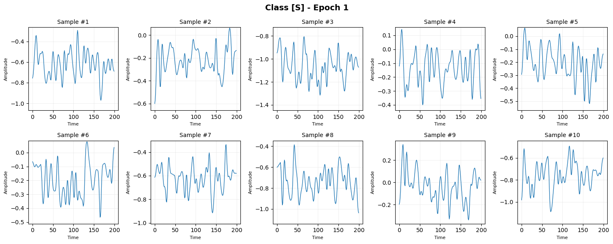
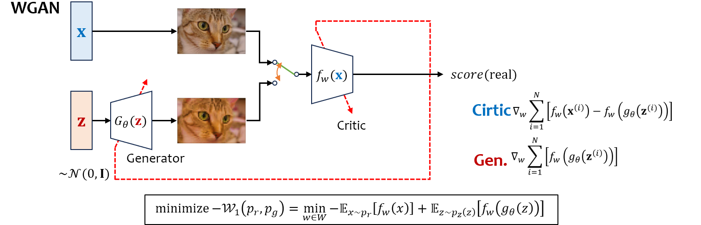

# ECG-Signal-Generation-Using-TCWGAN-GP


## ECG Generation Using a Transformer-Based GAN



This project generates synthetic ECG signals using a Transformer-based generator and a convolutional discriminator trained with the Wasserstein GAN with Gradient Penalty (WGAN-GP) framework.

The generator transforms a random latent vector into a 200-sample ECG signal using Transformer encoder blocks and linear interpolation upsampling.

## WGAN-GP Architecture



The WGAN-GP framework consists of a generator \(G_\theta(z)\), which generates synthetic samples from random noise \(z\), and a critic \(f_W(x)\), which evaluates real and generated samples. The critic is trained using the Wasserstein objective with a gradient penalty.
## Key Features

- **Signal length:** 200 samples
- **Generator:** MLP + Transformer encoder blocks + linear interpolation
- **Discriminator:** 1D convolutional neural network
- **Training framework:** WGAN-GP
- **Output:** Synthetic one-dimensional ECG signals
- **Visualization:** Generated ECG waveforms across training epochs

## Generator Architecture

The generator maps a 256-dimensional noise vector to a 200-sample ECG signal.

```python
TCGAN1D_Generator(
    noise_dim=256,
    embed_dim=512,
    output_length=200
)
```

The generator consists of the following stages:

1. **Latent projection:** Maps the noise vector to a sequence of 50 feature vectors.
2. **Transformer Stage 1:** Applies 5 Transformer encoder blocks.
3. **Upsampling Stage 1:** Increases the sequence length from 50 to 100 using linear interpolation.
4. **Transformer Stage 2:** Applies 4 Transformer encoder blocks.
5. **Upsampling Stage 2:** Increases the sequence length from 100 to 200 using linear interpolation.
6. **Signal projection:** Converts each 512-dimensional feature vector into a single signal value.

```text
Noise [B, 256]
      |
      v
     MLP
      |
      v
 [B, 50, 512]
      |
      v
Transformer × 5
      |
      v
Upsampling (50 → 100)
      |
      v
Transformer × 4
      |
      v
Upsampling (100 → 200)
      |
      v
Linear Projection (512 → 1)
      |
      v
ECG Signal [B, 200]
```

Here, `B` denotes the batch size.

### Generator Parameters

| Parameter | Value |
|---|---:|
| `noise_dim` | 256 |
| `embed_dim` | 512 |
| `initial_length` | 50 |
| Transformer blocks | 5 + 4 |
| Attention heads | 8 |
| `mlp_ratio` | 4 |
| `output_length` | 200 |

## Discriminator Architecture

The discriminator evaluates ECG signals using convolutional feature extraction and global average pooling.

```python
TCGAN1D_Discriminator(
    signal_length=200
)
```

```text
ECG Signal [B, 200]
      |
      v
Add Channel Dimension
      |
      v
Conv1D (1 → 64)
      |
      v
Conv1D (64 → 128)
      |
      v
Conv1D (128 → 256)
      |
      v
Conv1D (256 → 512)
      |
      v
Final Conv1D (512 → 1)
      |
      v
Global Average Pooling
      |
      v
Score [B, 1]
```

The discriminator uses four stride-2 convolutional layers followed by a final convolution and global average pooling. Batch normalization and LeakyReLU are used in the intermediate convolutional blocks.

The output is a raw scalar score without a sigmoid activation, consistent with the critic formulation used in WGAN-GP.

## Signal Length and Data Extraction

Each generated ECG signal contains 200 samples, corresponding to approximately 0.56 seconds at a sampling frequency of 360 Hz.

```python
pre = int(round(90 * fs / 360.0))
post = int(round(110 * fs / 360.0))

# Total: 200 samples when fs = 360 Hz
```

The extraction window contains 90 samples before the R-peak and 110 samples from the R-peak onward, according to the dataset extraction convention.

## Dataset Preparation

Run the dataset-generation script:

```bash
python gen_dataset_inter_patient_200s.py
```

Expected dataset structure:

```text
dataset/
└── mitbih_interpatient/
    ├── mitbih_train.npz
    └── mitbih_test.npz
```

The actual output paths depend on the dataset-generation script.

## Training

The generator and discriminator are defined in the model implementation. The training script should configure the WGAN-GP optimization procedure.

Example command using the existing project naming convention:

```bash
python train_TransGAN.py
```

The training script's actual filename, optimizer settings, batch size, number of critic updates, and checkpoint paths should be verified against the implementation.

## Generated Samples

Generated ECG signals can be organized by class and epoch.

```text
generated_samples/
├── S_epochs/
│   ├── epoch_0001/
│   │   ├── sample_01.png
│   │   ├── sample_01.npy
│   │   └── ...
│   └── epoch_0050/
├── V_epochs/
└── F_epochs/
```

- `.png`: ECG waveform visualization.
- `.npy`: Numerical ECG signal, if enabled in the saving script.
- Epoch directories: Generated samples saved at different training stages.

The number of samples saved per epoch depends on the training script.

## GAN-Based Data Augmentation

Synthetic ECG signals can be used to augment underrepresented classes in the training dataset.

Example configuration:

```python
GAN_AUGMENT_CONFIG = {
    "S": {
        "enabled": True,
        "checkpoint": "log/model_S/models/S_epoch_50.pth",
        "multiplier": 4,
    },
    "V": {
        "enabled": True,
        "checkpoint": "log/model_V/models/V_epoch_50.pth",
        "multiplier": 2,
    },
    "F": {
        "enabled": True,
        "checkpoint": "log/model_F/models/F_epoch_50.pth",
        "multiplier": 4,
    },
}
```

Update the checkpoint paths and augmentation multipliers according to the available models and dataset-generation implementation.

## Project Structure

```text
project/
├── images/
│   └── gen_example.gif
├── TransGAN.py
├── train_TransGAN.py
├── gen_dataset_inter_patient_200s.py
├── dataset/
│   └── mitbih_interpatient/
├── log/
└── generated_samples/
```

## References

- Gulrajani et al., [Improved Training of Wasserstein GANs](https://arxiv.org/abs/1704.00028).
- [MIT-BIH Arrhythmia Database](https://physionet.org/content/mitdb/).
- Vaswani et al., [Attention Is All You Need](https://arxiv.org/abs/1706.03762).
